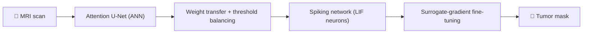

<!-- Save as README.md in a PUBLIC repo named exactly: hkbit03/hkbit03 -->

<div align="center">

[](https://githubcard.com/hkbit03/card?utm_source=github&utm_medium=readme)

[](https://git.io/typing-svg)


[](https://linkedin.com/in/harikrishnan106)
[](mailto:hari.krishnan.work03@gmail.com)
[](https://doi.org/10.1109/ICSCST70031.2026.11709866)

</div>

---

## ⏱️ 30-Second Recruiter Summary

| | |
|---|---|
| 🎯 **Looking for** | Entry-level Full-Stack / Backend / Python Developer roles (open to Data and ML-adjacent roles) |
| 🎓 **Education** | Integrated MCA, Amrita Vishwa Vidyapeetham, Kochi · 2026 · CGPA 7.92 |
| 🛠️ **Core stack** | Node.js · Express · MongoDB · Python · Pandas · REST APIs · Tailwind |
| 📄 **Proof of depth** | Peer-reviewed paper on IEEE Xplore, beating prior published Dice scores |
| ⚡ **I care about** | Query performance, clean APIs, responsive UIs, data that can be trusted |
| 📅 **Available** | Immediately · open to relocation and remote |

---

## 🧑‍💻 `hari.py`

```python
class Hari:
    def __init__(self):
        self.role      = "Full-Stack & Python Developer"
        self.education = "Integrated MCA '26 @ Amrita Vishwa Vidyapeetham"
        self.published = "IEEE Xplore · ICSCST 2026"
        self.strengths = ["MongoDB indexing", "REST API testing",
                          "Data pipelines", "Debugging & troubleshooting"]
        self.tools     = ["Git", "Postman", "Jupyter", "Claude Code CLI"]
        self.mindset   = "Agile, collaborative, always learning"

    def next_goal(self):
        return "Ship real features with a great engineering team 🚀"
```

---

## 💫 About Me

🔭 **Working on:** full-stack projects with Node.js, Express and MongoDB, and my next step as a developer after graduating (MCA 2026)<br>
👯 **Collaborate on:** open-source web apps, Python automation tools, and deep learning / healthcare AI research<br>
🤝 **Looking for help with:** landing my first full-time Full-Stack / Backend / Python Developer role, plus system design and scalability best practices<br>
🌱 **Learning:** advanced backend architecture, performance tuning, and AI-assisted development with Claude Code<br>
💬 **Ask me about:** full-stack development, MongoDB indexing, Python data pipelines, REST API testing, or spiking neural networks<br>
⚡ **Fun fact:** my research turns a standard neural network into a brain-inspired spiking one that finds brain tumors in MRI scans more accurately than earlier published results

---

## 🚀 Featured Projects

<table>
<tr>
<td width="33%" valign="top">

### 🗂️ Service Management & Analytics Platform
Role-based dashboards that track project performance, task lifecycles and system telemetry in real time.

**Impact:** custom MongoDB schemas and indexes cut query latency and removed bottlenecks.

`Node.js` `Express` `MongoDB` `Tailwind`

[**View repo →**](https://github.com/hkbit03/CSP)

</td>
<td width="33%" valign="top">

### 🧹 Automated Data Cleaning Pipeline
Cleans and validates employee records with **3-sigma statistical outlier detection**.

**Impact:** interactive Excel dashboards for dataset health monitoring and error triage.

`Python` `Pandas` `NumPy` `Excel`

[**View repo →**](https://github.com/hkbit03/Data-Cleaning-Pipeline-for-Employee-Data)

</td>
<td width="33%" valign="top">

### 🔎 FEX2: System Search Utility
Desktop search with **fuzzy matching (BK-Tree)** and sub-second results across large NTFS volumes via the Everything SDK.

**Impact:** tuned background indexing so the UI stays responsive and the system stable.

`Python` `PyQt6` `NTFS/MFT`

[**View repo →**](https://github.com/hkbit03/FEX_2025)

</td>
</tr>
</table>

---

## 🧠 Research: Teaching a Neural Network to Spike

> **ANN-SNN Framework using Visual Attention for Precise and Efficient Brain Tumor Segmentation**
> ICSCST 2026 · IEEE Xplore · [DOI 10.1109/ICSCST70031.2026.11709866](https://doi.org/10.1109/ICSCST70031.2026.11709866)



| Model | Dice score | Best prior published |
|---|---|---|
| Attention U-Net | **0.8232** | 0.779 |
| U-Net SNN | **0.8155** | 0.7809 |

Evaluated on a 3,064-image brain tumor MRI dataset.

---

## 💻 Tech Stack

<details open>
<summary><b>🔧 Click to collapse / expand</b></summary>
<br>

**Languages & Web**<br>


**Databases**<br>


**Data & Deep Learning**<br>


**Tools**<br>


</details>

---

## 🎓 Education & Certifications

- 🎓 **Integrated MCA** · Amrita Vishwa Vidyapeetham, Kochi · 2021 – 2026 · CGPA 7.92
- 🏅 **Claude Code 101** · Anthropic Academy
- 🏅 **Python for Data Science, AI & Development** · IBM (Coursera)
- 🏅 **SQL & Relational Databases** · IBM (Cognitive Class)

---

## 📊 GitHub Stats

<div align="center">


</div>

---

## 🤝 Let's Build Something Together

<div align="center">

If your team needs someone who can **ship full-stack features, clean up messy data, and pick up new tools fast**, I'd love to chat.

[](mailto:hari.krishnan.work03@gmail.com)
[](https://linkedin.com/in/harikrishnan106)


</div>
